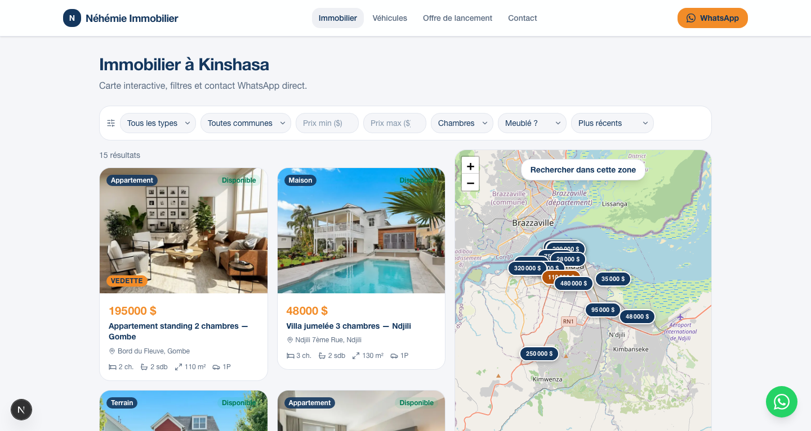
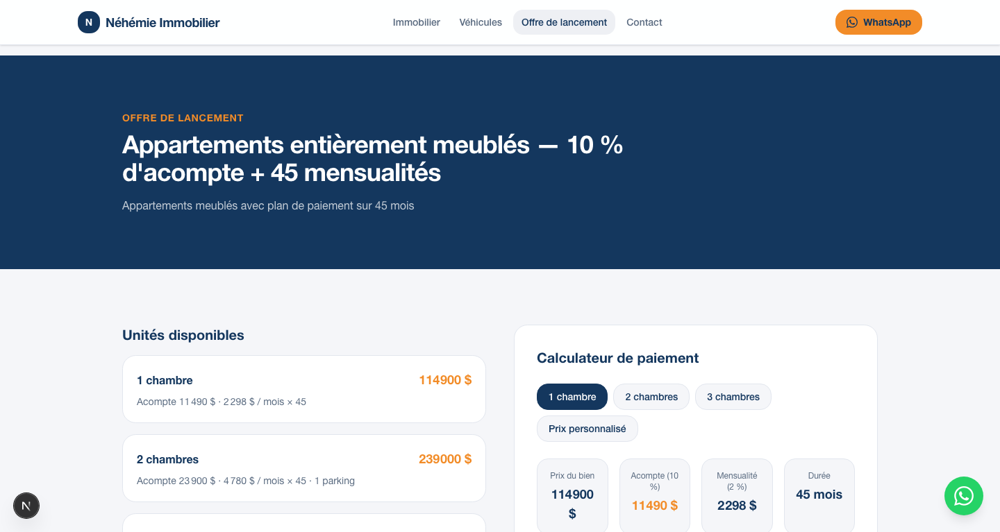
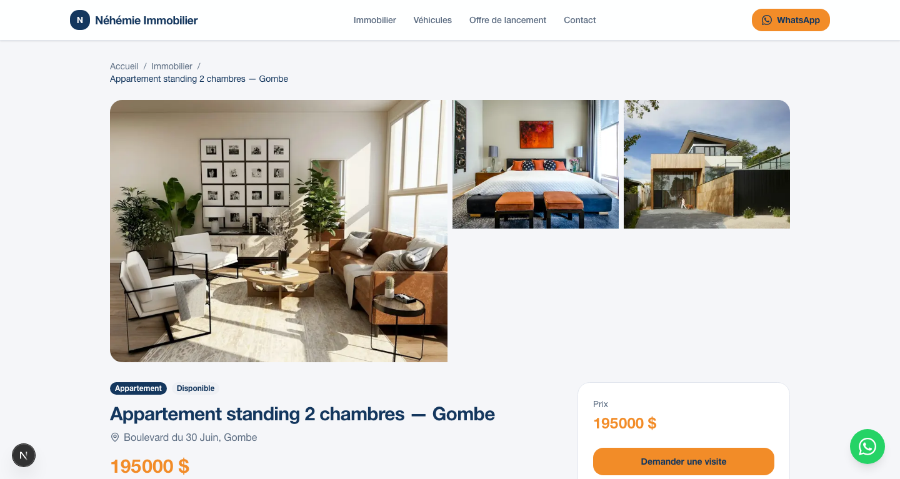
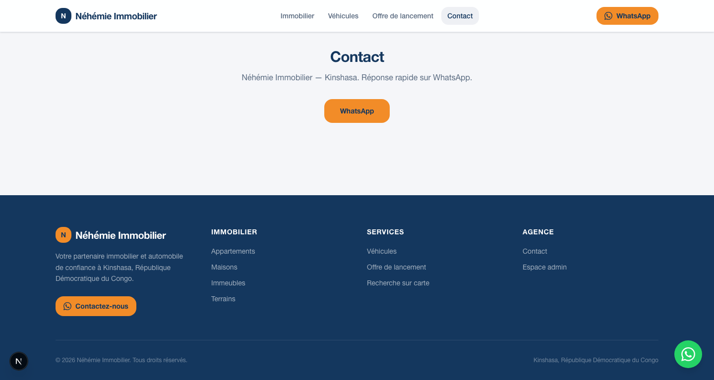

# Néhémie Immobilier

Plateforme web de **location & vente immobilière et automobiles à Kinshasa**.  
Recherche sur carte, fiches biens, offre de lancement avec calculateur de paiement, et contact WhatsApp direct.

**Repo :** [github.com/Eliott243/app_location](https://github.com/Eliott243/app_location)

---

## Aperçu

| Accueil | Recherche + carte |
| :---: | :---: |
|  |  |

| Véhicules | Offre de lancement |
| :---: | :---: |
|  |  |

| Fiche bien | Contact |
| :---: | :---: |
|  |  |

---

## Fonctionnalités

- **Immobilier** — appartements, maisons, immeubles, terrains (filtres type / commune / prix / chambres / meublé)
- **Carte interactive** (Leaflet) — pastilles prix, survol liste ↔ carte, recherche dans la zone
- **Fiches biens** — galerie photos, caractéristiques, CTA WhatsApp « Demander une visite »
- **Véhicules** — catalogue automobile avec fiches dédiées
- **Offre de lancement** — appartements meublés, acompte 10 %, 45 mensualités + calculateur
- **Contact WhatsApp** — bouton fixe + messages préremplis
- **i18n** FR / EN
- **Admin** (stub) pour la suite back-office

---

## Stack

| Couche | Techno |
| --- | --- |
| Framework | Next.js 16 (App Router) + React 19 |
| Style | Tailwind CSS 4, design navy / orange |
| Carte | Leaflet + OpenStreetMap |
| Images | `next/image` + Unsplash (seed) |
| Motion | Framer Motion |
| Données | Seed TypeScript (prêt pour Supabase) |

---

## Démarrage rapide

```bash
git clone https://github.com/Eliott243/app_location.git
cd app_location
npm install
cp .env.example .env.local
npm run dev
```

Ouvrir [http://127.0.0.1:3000](http://127.0.0.1:3000).

### Variables d’environnement

Voir `.env.example` :

```env
NEXT_PUBLIC_AGENCY_NAME=Néhémie Immobilier
NEXT_PUBLIC_WHATSAPP=243XXXXXXXXX
```

---

## Structure du projet

```
app/                 # Pages (accueil, recherche, biens, véhicules, projet, contact, admin)
components/          # UI, carte, filtres, galerie, layout
config/              # Marque, formatage prix, WhatsApp
data/                # Seed listings, photos, communes, offre de lancement
lib/                 # Listings, filtres, i18n
messages/            # FR / EN
docs/screenshots/    # Captures pour la documentation
```

---

## Scripts

| Commande | Description |
| --- | --- |
| `npm run dev` | Serveur de développement (webpack, sans source maps) |
| `npm run build` | Build production |
| `npm start` | Serveur production |
| `npm run lint` | ESLint |

---

## Captures détaillées

### Accueil
Hero de marque, CTA vers les biens et l’offre de lancement, accès WhatsApp.

### Recherche immobilière
Liste filtrable + carte Kinshasa avec pastilles de prix. Clic sur une pastille → popup + lien fiche.

### Fiche bien
Galerie (salon / chambre / cuisine…), prix, localisation, demande de visite WhatsApp.

### Véhicules
Catalogue auto (SUV, pick-up…) avec le même parcours contact.

### Offre de lancement
Unités meublées 1–3 chambres et calculateur (acompte, mensualité, durée).

---

## Roadmap (suite possible)

- [ ] Connexion Supabase (listings réels, admin CRUD)
- [ ] Upload photos + stockage
- [ ] Auth admin
- [ ] Déploiement Vercel / hébergement

---

## Licence

Projet privé — Néhémie Immobilier / Eliott. Tous droits réservés.
